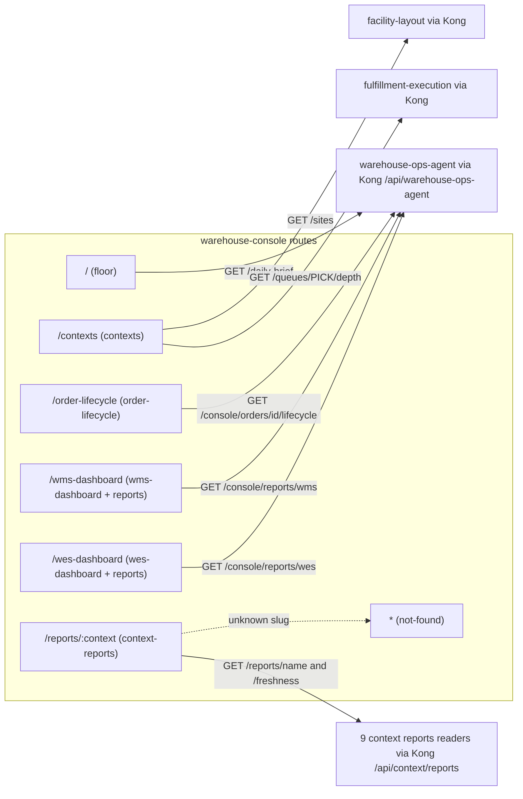

# Feature modules (`src/features/*`)

Everything the shell renders itself lives under `src/features/`, one
directory per screen (or shared screen body). Remote screens are not here:
they are lazy-loaded from their own repos (see
[Module Federation](./module-federation.md)). The shell-level glue the
features share lives in `src/shell/`.

| Module | Route(s) | Entry component | Reads | Tests |
|---|---|---|---|---|
| `src/features/floor` | `/` | `FloorScreen` | `GET <BFF>/daily-brief`, polled every 15 s | `FloorScreen.test.tsx` |
| `src/features/contexts` | `/contexts` | `ContextsScreen` | `GET <fulfillment-execution>/queues/PICK/depth` and `GET <facility-layout>/sites`, polled every 30 s | `ContextsScreen.test.tsx` |
| `src/features/order-lifecycle` | `/order-lifecycle` | `OrderLifecycleScreen` | `GET <BFF>/console/orders/<orderId>/lifecycle`, once per search | `toTimelineSteps.test.ts` |
| `src/features/wms-dashboard` | `/wms-dashboard` | `WmsDashboardScreen` | `GET <BFF>/console/reports/wms` | no unit test; `npm run verify:dashboards` |
| `src/features/wes-dashboard` | `/wes-dashboard` | `WesDashboardScreen` | `GET <BFF>/console/reports/wes` | no unit test; `npm run verify:dashboards` |
| `src/features/reports` | — (shared body) | `ReportDashboard` | the URL its caller passes | no unit test; `npm run verify:dashboards` |
| `src/features/context-reports` | `/reports/:context` | `ContextReportRouteScreen` → `ContextReportScreen` | `GET <context>/reports/<name>?from=&to=` plus `GET <context>/reports/<name>/freshness` | `ContextReportScreen.test.tsx`, `facilityLayout.config.test.tsx`, `fulfillmentExecution.config.test.tsx` |
| `src/features/not-found` | `*` and unknown `/reports/:context` slugs | `NotFoundScreen` | nothing | no unit test; `npm run verify:routes` (`/no-such-screen`) |

`<BFF>` is `<apiOrigin>/api/warehouse-ops-agent` and `<context>` is
`<apiOrigin>/api/<context>` (see [Configuration](../operations/configuration.md#urls-derived-from-apiorigin)).

Source: `src/App.tsx`, `src/config.ts`, `src/features/*/*.tsx`.

## `floor` — the monitor surface

`FloorScreen` (`src/features/floor/FloorScreen.tsx`) is the landing route
`/` and the console's wall-display view (`data-surface="monitor"`). It is
built entirely on warehouse-ops-agent's `GET /daily-brief`, polled every
15 000 ms through the ui-kit's `useFetch` (safe to poll: the brief is a pure
read).

- **Shape** (`src/features/floor/types.ts`): `DailyBrief { generatedAt, sites[], openExceptions[] }`;
  each `SiteBrief` has `siteCode`, `siteName`, `paths[]`; each `PathBrief`
  carries nullable `backlog { backlogDepth, wip, overAlarmThreshold }`,
  `staffing { plannedHeads, activeHeads, understaffed }`, `queue { depth }`,
  `stuck { count }`, plus `unavailable[]` (`"<service>: <reason>"`) and
  `exceptions[]`. An `OpenException` has `kind` (only `flow_balance_risk`
  exists today), `siteCode`, `pathId`, `severity` (`info` / `warning` /
  `critical`), `summary` and `evidence[]`.
- **What it renders**: a summary row (Sites, Paths, Critical, Warning, Feeds
  down), a "Needs attention" list sorted by `SEVERITY_RANK`
  (critical → warning → info) with an expandable evidence list, and one card
  per site/path with Backlog, WIP, Queue, Heads (`active/planned`) and Stuck.
  A path card takes the colour of its worst exception.
- **Rules**: every alarm colour comes from a backend flag
  (`overAlarmThreshold`, `understaffed`, `severity`); the only comparison
  the screen makes is `stuck.count > 0`, which mirrors warehouse-ops-agent's
  own exception derivation. A missing fact renders `—` in warning tone with a
  visually-hidden "no signal" label, never `0`; each `unavailable[]` entry
  renders as "no signal from `<service>`".
- **States**: first load → "Reading the floor…"; error with no prior data →
  "The floor view is unavailable" plus a **Try again** button; a failed
  refresh after a good read keeps the last data and the header says
  "refresh failed — showing last known"; otherwise "updated `<n>` ago" with a
  **Refresh** button. The tab title is `Floor · Warehouse Console`.

## `contexts` — the launchpad

`ContextsScreen` renders one `LaunchTile` per destination: three
cross-service tiles (Order Lifecycle, WMS Dashboard, WES Dashboard) and
eighteen bounded-context tiles linking to the remote routes. Two tiles carry
live badges, polled every 30 000 ms: Fulfillment (`<depth> in PICK` from
`GET /queues/PICK/depth`) and Facility (`<n> site(s)` from `GET /sites`). A
failed badge read simply omits the badge.

Each tile whose `context` matches an entry in
`src/features/context-reports/registry.ts` (`REPORT_ROUTES`) gets a sibling
"View metrics report →" link to `/reports/<context>` (a sibling, because a
link nested inside the tile's own anchor is invalid HTML).

## `order-lifecycle` — one order across four contexts

`OrderLifecycleScreen` takes an order id from a search form (trimmed; empty
input is ignored) and calls
`GET <BFF>/console/orders/<encodeURIComponent(orderId)>/lifecycle`. The
response (`types.ts`) has four independently nullable stages:
`orderManagement`, `inventory`, `planning`, `fulfillment`.

`toTimelineSteps.ts` is the pure mapping from that payload to the ui-kit
`Timeline`. It keeps **pending** ("not yet") apart from **unavailable**
("we asked and got nothing"): a `null` stage emits `unavailable` steps with
reason "No signal from `<context>`". Mapping highlights:

- order-management → "Order received" and an allocation step whose title and
  state follow `status` (`Allocated` → done, `PartiallyAllocated` /
  `Backordered` → warning, `Cancelled` → error, `Released` /
  `PartiallyReleased` → done, anything else → active). Backordered lines
  become warnings; at most 6 lines are spelled out, the rest collapse to
  `+N more`.
- inventory-storage → "Stock reserved" (done when any reservation exists).
- wes-work-planning → "Work released" with work-unit count, distinct path ids
  and "special handling" when any unit is fragile or gift-wrapped.
- fulfillment-execution → one step **per** PICK / PACK / SLAM task
  (`PENDING` → pending, `CLAIMED` → active, `COMPLETED` → done), with
  warnings for lease expiries and SLAM weight discrepancies; then separate
  "Package sealed" and "Label applied" steps (sealed but unlabeled is a
  warning).

This screen does not set a document title.

## `wms-dashboard`, `wes-dashboard` and `reports`

`WmsDashboardScreen` and `WesDashboardScreen` are thin wrappers that pass a
title, subtitle and `CONSOLE_REPORTS_URL.wms` / `.wes` to the shared
`ReportDashboard` (`src/features/reports/ReportDashboard.tsx`). The BFF
applies its own default window (trailing 24 h); the shell sends no
`from`/`to`.

The envelope (`src/features/reports/types.ts`) is
`ReportResponse { from, to, generatedAt, sections[] }`; each `ReportSection`
has `id`, `title`, `sourceContext`, `chartKind` (`funnel` | `bar` | `line`),
`available`, `error`, `freshnessLagSeconds` and `series[]` of
`{ label, value }`. `ReportDashboard` renders:

- a whole-request failure as one "Dashboard temporarily unavailable" card,
  with no numbers;
- each `available: false` section as a "Data unavailable" card showing
  `error` (or "`<sourceContext>` did not answer for this window."), while the
  other sections still draw;
- each available section with `FunnelChart` / `BarChart` / `LineChart` by
  `chartKind`, a `FreshnessBadge` from `freshnessLagSeconds`, and the source
  context; an unknown `chartKind` says "Unsupported chart type" instead of
  guessing.

## `context-reports` — per-context Bounded Context Report screens

One route, `/reports/:context`, resolved by `ContextReportRouteScreen` against
`REPORT_ROUTES`; an unknown slug renders `NotFoundScreen`. Each entry's config
(`ContextReportConfig`: `contextId`, `title`, `subtitle`, `reportUrl`,
`freshnessUrl`, `renderBody`) points at that context's **own** reports reader
through Kong, never through the BFF. `ContextReportScreen` owns loading,
whole-request error ("Report temporarily unavailable") and a
`FreshnessBadge` fed by `/freshness` (`{ lagSeconds }`; on failure the badge
shows unknown and the body still renders). `renderBody` maps each context's
own DTO onto ui-kit `Card` / `DataTable` / chart primitives.

| Slug | Config file | Title | Report path | Window |
|---|---|---|---|---|
| `order-management` | `orderManagement.config.tsx` | Orders: Funnel & Allocation Health | `/reports/funnel` | trailing 24 h |
| `inventory-storage` | `inventoryStorage.config.tsx` | Inventory: Flow & Accuracy | `/reports/flow-accuracy` | trailing 24 h |
| `wes-work-planning` | `wesWorkPlanning.config.tsx` | Planning: Release Throughput & Backlog | `/reports/throughput` | trailing 24 h |
| `fulfillment-execution` | `fulfillmentExecution.config.tsx` | Fulfillment: Throughput | `/reports/throughput` | trailing 24 h |
| `workforce-management` | `workforceManagement.config.tsx` | Workforce: Labor Utilization & Staffing | `/reports/labor` | trailing 24 h |
| `facility-layout` | `facilityLayout.config.tsx` | Facility: Catalog Growth | `/reports/catalog-growth` | trailing 30 d |
| `process-path-management` | `processPathManagement.config.tsx` | Process Paths: Catalogue Growth | `/reports/catalogue-growth` | trailing 30 d |
| `labor-performance` | `laborPerformance.config.tsx` | Labor: Performance | `/reports/performance` | trailing 24 h |
| `network-fulfillment` | `networkFulfillment.config.tsx` | Network Fulfillment: Acknowledgement & Translation | `/reports/acknowledgement` | trailing 30 d |

Every path above matches the `GET /reports/...` route (and its `/freshness`
sibling) registered by that context's reports router on its `develop`
branch.

The network-fulfillment screen renders every field of that context's
`acknowledgementRowDTO` (`internal/adapters/inbound/http/reports_handler.go`,
`AcknowledgementReportRow` in its `apis/openapi.yaml`): `dayBucket`,
`ordersReceived`, `ordersAcknowledged`, the four rejection causes
(`ordersRejectedUntranslatableSku`, `ordersRejectedDomain`,
`acknowledgementDeadlinesMissed`, `ordersRejectedSubmissionFailed`) and
`avgAcknowledgementLatencySeconds` (shown as a duration). The report is
day-bucketed (`granularity=day` is its only value), hence the 30-day window.

`reportWindow.ts` builds the window (`trailingHours`, `trailingDays`) and
appends it as RFC 3339 `from`/`to` query parameters (`withWindow`). Each
config computes its `WINDOW` **once at module load**, so the window ends at
the moment the bundle was loaded, not at the moment the screen is opened;
reload the page to move it forward.

Kong routes `/api/<context>/reports` to the separate `<context>-reports`
Service (warehouse-infra `terraform/services.tf`, and
`terraform/network-fulfillment.tf` for network-fulfillment), stripping the
prefix so the reader sees `/reports/...`. Whether a screen resolves therefore
depends on that context's reports deployment, not on the console.

## `not-found`

`NotFoundScreen` (`src/features/not-found/NotFoundScreen.tsx`) is the
catch-all `*` route and the fallback for an unknown `/reports/:context` slug.
It renders a "Page not found" card ("That address doesn't match any screen in
the console.") with a **Back to the Floor** link to `/`, and sets the tab
title to `Page not found · Warehouse Console`. Because nginx falls back to
`index.html` for every unknown path, this screen — not an nginx 404 — is what
a mistyped deep link shows.

## Shared shell helpers (`src/shell/`)

| File | Role |
|---|---|
| `RemoteBoundary.tsx` | wraps each lazy remote in `Suspense` (a 240 px skeleton card) and an error boundary that renders "This module is unavailable right now" instead of blanking the console |
| `RouterLink.tsx` | adapts react-router's `Link` to the ui-kit `LinkComponent` contract (installed via `NavigationProvider` in `App.tsx`); absolute and protocol-relative URLs fall through to a plain `<a>` |
| `useDocumentTitle.ts` | sets `document.title` to `<title> · Warehouse Console` (or just `Warehouse Console`) |

Navigation (the items in `src/shell/useShellNav.ts`, rendered by the shell in `src/App.tsx`): the top bar has five items — Floor, Order
Lifecycle, WMS Dashboard, WES Dashboard, Contexts. "Contexts" is also
highlighted on `/reports/...` and on every remote prefix.
