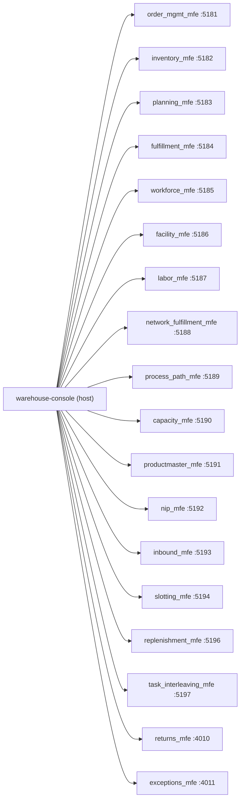

# Module Federation

This app is the federation **host** (`@module-federation/vite`); each of the
eighteen remotes is built and deployed independently by its own bounded-context
repo. The ports in the diagram are the remotes' **dev-server** ports, used by
`npm run dev`.



## Where a remote is loaded from

`vite.config.ts` picks each remote's entry at build time:

| Mode | Remote entry |
|---|---|
| `npm run dev` | `http://localhost:<dev-port>/remoteEntry.js` (ports above) |
| `vite build` (the image) | `/mfes/<context>/remoteEntry.js` |

In the kind cluster the Nginx web gateway on `http://localhost` serves this
shell at `/` and each remote at `/mfes/<context>/` — `order-management`,
`inventory-storage`, `wes-work-planning`, `fulfillment-execution`,
`workforce-management`, `facility-layout`, `process-path-management`,
`labor-performance`, `network-fulfillment`, `warehouse-planning`, `product-master`,
`network-inventory-planning`, `inbound-receiving`, `slotting-optimization`,
`pick-face-replenishment`, `task-interleaving`, `returns-processing`,
`exception-management`. The entry path is same-origin with the shell, so no
remote needs a CORS policy for its assets. Kong on `http://localhost:8000`
serves only the APIs and never handles HTML, JavaScript or CSS.

`capacity_mfe` (warehouse-planning) differs from its siblings in one way
worth knowing: it renders its own `<Routes>` with relative routes (overview,
`paths`, `plans`), so the host mounts it on the splat route `/capacity/*`.
Its API calls (`GET`, `POST` and `PUT` with a JSON `Content-Type`) go
cross-origin to `<apiOrigin>/api/warehouse-planning` on Kong, so Kong's CORS
policy for the console origin must allow `PUT`.

`productmaster_mfe` (product-master) follows the same shape: no props,
relative routes (product list, `register`, `products/:sku`, `products/:sku/packaging`), mounted on the
splat route `/product-master/*`. Its writes are `PUT` (register, classify, dimensions, declare a pack level) and `POST .../pack-levels/{level}:retire`, each with a JSON
`Content-Type` to `<apiOrigin>/api/product-master`, so Kong's CORS policy for the
console origin must allow `PUT` and `POST` (product-master's chart already lists both).

`nip_mfe` (network-inventory-planning) also exposes `./App` with no props and
relative routes (transfers, `transfers/:id`, `simulation`, `rebalance-runs`),
mounted on the splat route `/network-inventory/*`. Its only write is
`POST /v1/transfers:approve` with a JSON `Content-Type` **and an
`Idempotency-Key` header** to `<apiOrigin>/api/network-inventory-planning`, so
Kong's CORS policy for the console origin must also allow the
`Idempotency-Key` request header; warehouse-infra's `warehouse-cors` plugin
(`terraform/kong-cors.tf`) allows `Accept`, `Content-Type`, `Origin` and
`Idempotency-Key`. Without that header in the list the browser's preflight
rejects the Approve action while the read screens keep working.

`inbound_mfe` (inbound-receiving) exposes `./App` with no props and relative
routes (`asns`, `asns/register`, `asns/:asnNumber`, `appointments`, `receipts`,
`receipts/:receiptId`), mounted on the splat route `/inbound-receiving/*`. Every
create `POST` it makes (`/asns`, `/appointments`, `/receipts`,
`/receipts/{id}/lines`) carries a JSON `Content-Type` **and an `Idempotency-Key`
header** to `<apiOrigin>/api/inbound-receiving`; the action `POST`s (`cancel`,
`check-in`, `close`) send the header too, so Kong's CORS policy for the console
origin must allow `Idempotency-Key` (and `If-Match`, which the remote does not
send today) as request headers.

`slotting_mfe` (slotting-optimization), `replenishment_mfe`
(pick-face-replenishment) and `task_interleaving_mfe` (task-interleaving) each
expose `./App` with no props and are mounted on the splat routes `/slotting/*`,
`/pick-face-replenishment/*` and `/task-interleaving/*`. The route slug is not
always the repo name (`/slotting`), the gateway path always is. A gateway path
only exists once warehouse-infra's `apps.yaml` carries `frontend_remote` for
the context; without it the shell shows the inline "unavailable" card for that
remote, not a blank page.

`returns_mfe` (returns-processing, dev :4010) and `exceptions_mfe`
(exception-management, dev :4011) follow the same shape — `./App` with no
props, mounted on `/returns-processing/*` and `/exception-management/*` — but
their dev ports sit OFF the 51xx ladder on purpose: every 5181..5197 slot was
already taken, so their repos pinned 4010/4011 as free. Same
`frontend_remote` caveat as above.

`vite.config.ts` stays in object form (it reads `process.argv` for the build
flag) rather than the `({ command }) => ({...})` callback form, because
`vitest.config.ts` merges it with `mergeConfig`, which throws on a callback
export.

## No federated type generation

`vite.config.ts` sets `dts: false` on the federation plugin. The host never
consumes remote types: `src/App.tsx` imports every remote as
`// @ts-expect-error` plus `lazy(() => import("<name>/App"))`, and `tsconfig`
has no `@mf-types` paths. With the default settings the dev server tried to
download a types archive from each remote and printed "Failed to download types
archive" for every one of them, because no remote publishes one (the remotes
set `dts: false` too, after the `TYPE-001` build message). If typed remotes are
ever needed, re-enable `dts` in the host **and** in the remotes, then drop the
`@ts-expect-error` lines.

## Shared singletons

`react`, `react-dom`, `react-router-dom`, `@warehouse/ui-kit` are all shared
as singletons — a version mismatch on any of these fails loudly (React
throws on invalid hook state) rather than silently double-loading React and
producing hard-to-debug UI bugs.

## The lazy-loading rule

Each remote's `lazy()` call **must** be created exactly once, at module
scope, in `App.tsx` — never inside a component render:

```tsx
// correct: module scope, evaluated once
const FacilityRemote = lazy(() => import("facility_mfe/App"));

function Shell() {
  return <FacilityRemote />; // fine to reference the constant every render
}
```

Calling `lazy()` inside a render function remounts the remote on every parent
re-render — which happens on every navigation via `useLocation` — re-triggering
its Module Federation fetch and losing any internal state the remote was
holding. `RemoteBoundary` wraps every remote in a `Suspense` boundary (loading
skeleton) and an error boundary, so a remote that is down or broken renders an
inline "unavailable" card instead of white-screening the whole console.

## No shared business logic

Nothing in this repo talks to any bounded context's storage or business
rules directly. If a remote's screen needs data, it fetches it from its own
service's REST API at `<apiOrigin>/api/<context>`, reading `apiOrigin` from
the `window.__WAREHOUSE_CONFIG__` object the shell publishes before it mounts
(see [Getting started](../overview/getting-started.md#runtime-configuration-configjson)).
The shell's only job is routing to the right remote and handling the
cross-cutting screens (see [Cross-cutting screens](./cross-cutting-screens.md))
that no single remote can answer.
