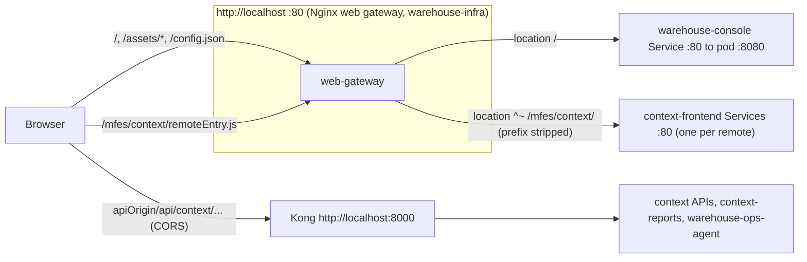

# Runbook

The console is a static bundle served by `nginx-unprivileged`. It has no
database, no Kafka, no migrations, no metrics endpoint and no backend process:
operating it means building the image, deploying the Helm chart with the
right `apiOrigin`, and keeping the web gateway, Kong and the remotes it points
at reachable.

## Topology



Source: `nginx.conf`, `vite.config.ts`, `charts/warehouse-console/`,
warehouse-infra `terraform/frontends.tf` and
`terraform/templates/web-gateway.conf.tftpl`.

The two edges never proxy to each other: the web gateway serves only
frontend bytes and Kong serves only APIs. Every API call from the console is
therefore cross-origin, and Kong's global `warehouse-cors` plugin
(warehouse-infra `terraform/kong-cors.tf`) grants exactly the web origin.

## Artifacts

| Artifact | Where | Produced by |
|---|---|---|
| Image | `ghcr.io/iqvo/warehouse-console:latest`, `:<short-sha>`, `:vX.Y.Z` | `ci.yml` `docker-publish` + `release`, push to `main` only; signed with cosign (keyless) and attested with an SPDX SBOM |
| Helm chart | `oci://ghcr.io/iqvo/warehouse-console`, version = release version; also attached to the GitHub release | `ci.yml` `release` |
| Local kind image | `warehouse/warehouse-console-frontend:local-<12-char source hash>` | warehouse-infra `scripts/build-and-load-frontend.sh` |
| Docs site | `https://iqvo.github.io/warehouse-console/` | `docs.yml`, push to `main` touching `docs/**` |

## Building the image

```bash
# from the repo root, with warehouse-ui-kit checked out as a sibling
docker build --build-context uikit=../warehouse-ui-kit -t warehouse-console:local .
```

The `Dockerfile` has three stages:

1. `uikit-build` (`node:26-bookworm-slim`): copies the `uikit` named context,
   removes its `node_modules` and lockfile, `npm install --no-save`,
   `npm run build`.
2. `build` (`node:26-bookworm-slim`): places the built ui-kit at
   `/workspace/warehouse-ui-kit`, `npm install --no-save` **without** the
   lockfile (the committed lock has no Linux entries for Vite's native
   bindings), then `npm run build` (`tsc -b && vite build`).
3. runtime (`nginxinc/nginx-unprivileged:1.31-alpine`): `apk upgrade` plus the
   pinned `pcre2>=10.49-r0` and `tiff>=4.7.2-r0` fixes, copies `nginx.conf`
   to `/etc/nginx/conf.d/default.conf` and `dist/` to `/usr/share/nginx/html`,
   runs as `nginx`, `EXPOSE 8080`.

No endpoint is baked in: the same image runs anywhere, given a
`/config.json`.

## Deploying (Helm chart `charts/warehouse-console`)

Resources the chart renders: one Deployment (one nginx container, port name
`http` = 8080), a ClusterIP Service on port **80** → `http`, a ServiceAccount,
the `<fullname>-runtime-config` ConfigMap (when `runtimeConfig.enabled`), an
optional Ingress (off by default) and an optional HPA (off by default). See
[Configuration](./configuration.md#helm-chart-values-chartswarehouse-consolevaluesyaml)
for every value.

```bash
helm upgrade --install warehouse-console oci://ghcr.io/iqvo/warehouse-console \
  --version <X.Y.Z> \
  --set image.tag=v<X.Y.Z> \
  --set runtimeConfig.apiOrigin=http://localhost:8000
```

The chart's default `image.repository` is `ghcr.io/iqvo/warehouse-console`,
the repository CI publishes; override it only for a locally built image (the
kind cluster sets `warehouse/warehouse-console-frontend:local-<hash>`, below).

### In the kind cluster (warehouse-infra)

- ArgoCD owns the release: Application `warehouse-console`
  (`terraform/argocd-apps.tf`), source `IQVO/warehouse-console` path
  `charts/warehouse-console` at **`develop`**, automated sync with prune and
  self-heal, destination the apps namespace. A chart change merged to
  `develop` reaches the cluster without a release.
- Values come from `local.console_helm_values` in `terraform/frontends.tf`:
  image `warehouse/warehouse-console-frontend:local-<hash>`, Service
  `ClusterIP` 80 → 8080, `ingress.enabled: false`,
  `runtimeConfig.apiOrigin = http://localhost:<kong_proxy_http_host_port>`.
- The image is rebuilt and side-loaded by `null_resource.build_and_load_console`
  whenever the hash of `src/**`, `package.json`, `vite.config.ts`,
  `index.html`, `Dockerfile`, `nginx.conf` or the ui-kit sources changes. The
  tag changes with the content, so the Deployment rolls by itself.
- The web gateway (`web-gateway` Deployment + NodePort Service, port 80)
  proxies `location /` to `warehouse-console.<apps-namespace>.svc.cluster.local:80`
  and each `/mfes/<context>/` to `<context>-frontend...:80`, resolving
  Service names at request time through kube-dns (`valid=10s`).

### Probes

Liveness and readiness both `GET /healthz` on port `http`; nginx answers
`200 ok` itself (`nginx.conf`), so readiness means "nginx is up", not "the
APIs or remotes are reachable". Liveness: initial delay 5 s, period 10 s;
readiness: initial delay 3 s, period 5 s.

## How remotes are discovered

They are not discovered at runtime. `vite.config.ts` compiles the list of 13
remotes into the shell; a production build loads each from the same-origin
path `/mfes/<context>/remoteEntry.js`, and `src/App.tsx` mounts it on a fixed
route (table in [Configuration](./configuration.md#module-federation-remotes-viteconfigts)).
Each remote is fetched lazily the first time its route renders.

Consequences:

- Adding or renaming a remote needs a console change **and** a matching
  `frontend_remotes` entry in warehouse-infra `terraform/frontends.tf`
  (which renders the gateway's `/mfes/<context>/` location).
- A remote that is not deployed is not an error at boot; only its own route
  shows the "This module is unavailable right now" card.

## Cache headers

| Path | Header | Set by |
|---|---|---|
| `/index.html` | `Cache-Control: no-cache` | console `nginx.conf` |
| `/config.json` | `Cache-Control: no-store` (and fetched with `cache: "no-store"`) | console `nginx.conf`, `src/runtime-config.ts` |
| `/assets/*` (content-hashed) | `Cache-Control: public, max-age=31536000, immutable` | console `nginx.conf` |
| `/mfes/<context>/remoteEntry.js` and remote assets | whatever the remote's own nginx sends | each remote repo's `web/nginx.conf` (not in this repo) |
| any other path | none (SPA fallback to `index.html`) | console `nginx.conf` |

## Routine procedures

### Check a deployment

```bash
curl -s http://localhost/healthz                    # web gateway itself
curl -sI http://localhost/ | grep -i cache-control   # shell index.html, expect no-cache
curl -s http://localhost/config.json                 # expect {"apiOrigin":"http://localhost:8000"}
curl -sI http://localhost/mfes/facility-layout/remoteEntry.js   # expect a JavaScript content type
curl -sI -H 'Origin: http://localhost' http://localhost:8000/api/facility-layout/sites
```

The last call should return `Access-Control-Allow-Origin: http://localhost`.

### Change `apiOrigin`

Set `runtimeConfig.apiOrigin` (in kind: `local.api_origin` in
warehouse-infra). The ConfigMap is mounted with `subPath`, which kubelet does
not live-update, but the `checksum/runtime-config` pod annotation changes
with it, so the pods roll. Browsers pick it up on the next page load
(`no-store`). Kong's CORS origin must match the **page** origin, not
`apiOrigin`.

### Roll out a new bundle / roll back

Outside kind: `helm upgrade` with the new `image.tag`; roll back with
`helm rollback warehouse-console <revision>`. In kind: merge to `develop` and
re-apply warehouse-infra (new content hash → new tag → rollout); ArgoCD
self-heals manual edits back to the Terraform values. Because `index.html` is
`no-cache` and assets are content-hashed, users get the new bundle on their
next full load; an open tab keeps running the old one until reloaded.

### Scale

Stateless; scale with `replicaCount` or `autoscaling.enabled: true` (CPU
target 80 %, 1–5 replicas). Requests are 100m CPU / 128Mi, limits 500m /
256Mi.

## Observability

The shell exports no metrics, traces or structured logs of its own:

- nginx access/error logs on the pod's stdout/stderr (`/healthz` is not
  logged). The web gateway logs `upstream=$upstream_addr` per request. The
  warehouse-infra Loki "logs overview" dashboard explicitly excludes
  `warehouse-console` and `web-gateway` from its error panels.
- Boot failures are written into the page itself
  (`warehouse-console failed to start: <message>`) and to the browser console.
- Remote failures show as a "This module is unavailable right now" card; the
  error message is printed only in development builds.

For diagnosis see [Troubleshooting](./troubleshooting.md).
